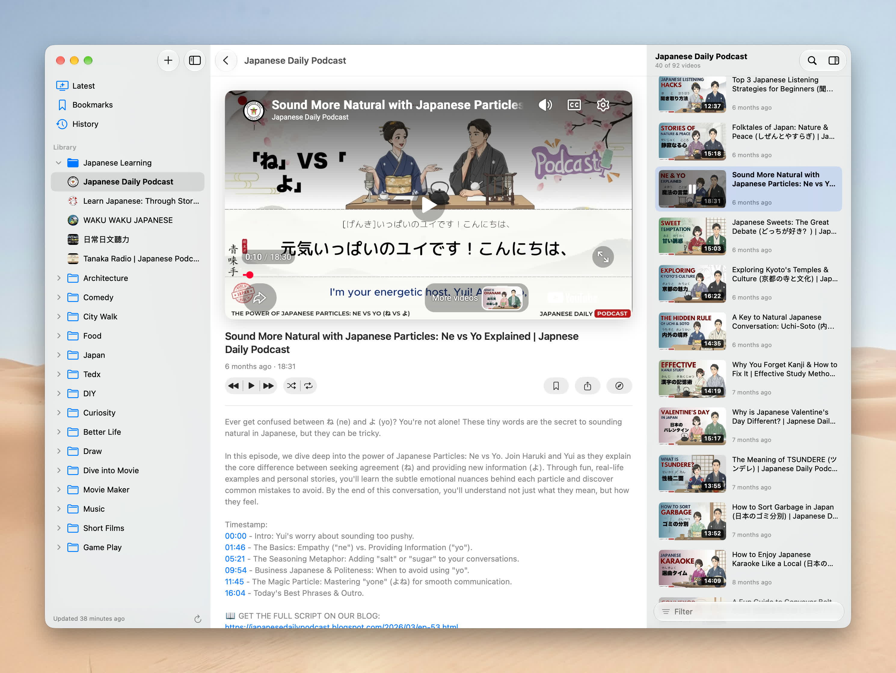

# Bower

A native macOS 26 app (SwiftUI + AppKit) for following YouTube playlists and channels
without the algorithm.



## Download

[Download the latest Bower](https://github.com/limboy/bower/releases/latest) (a notarized DMG; open
it and drag Bower to Applications). Requires macOS 26. Bower updates itself through
**Bower › Check for Updates…**.

## Build

```sh
xcodegen generate          # regenerates Bower.xcodeproj from project.yml
open Bower.xcodeproj
```

## Layout

- `App/` — entry point, menu commands, `AppModel` (selection, sheets, import/export)
- `Models/` — Codable models
- `Store/` — `LibraryStore` (library, folders, bookmarks, history, hidden videos), resume positions, description cache
- `YouTube/` — a small InnerTube client, URL classification, cookie handling
- `Services/` — refresh/add logic, image + avatar caching
- `Player/` — `YouTubePlayer` (iframe API inside one persistent WKWebView) and `PlaybackModel` (queue, shuffle, repeat)
- `Views/` — sidebar, now-playing pane, video list inspector, sheets, settings

Data lives in `~/Library/Application Support/me.limboy.Bower/`.

## Release

```sh
scripts/release.sh 2.1.0 [notes.md]
```

Bumps the version, tags `v2.1.0` and pushes. `.github/workflows/release.yml` then builds,
signs, notarizes and publishes the DMG, the zip and Sparkle's `appcast.xml` as a GitHub
release; the app checks `releases/latest/download/appcast.xml` for updates.
